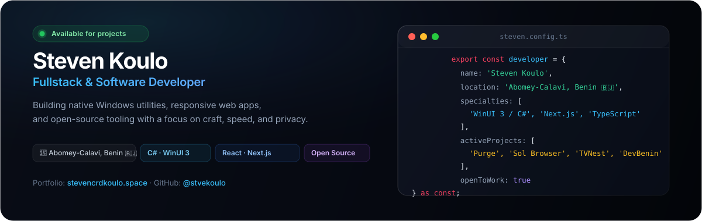

<picture>
  <source media="(prefers-color-scheme: dark)" srcset="./assets/readme/hero-dark.svg">
  <source media="(prefers-color-scheme: light)" srcset="./assets/readme/hero-light.svg">
  
</picture>

 

  
  
  
  

---

### About

Fullstack and software developer based in **Abomey-Calavi, Benin 🇧🇯**.

I engineer software from low-level systems up to polished user interfaces: high-performance native Windows applications with C# and WinUI 3, fullstack web platforms with Next.js and TypeScript, and open-source tooling. I prioritize offline-first execution, strict privacy with zero telemetry, and intentional interface design.

---

### Featured Projects &amp; Open Source

<table>
  <tr>
    <td width="50%" valign="top">
      <h3>🧹 <a href="https://github.com/stvekoulo/purge">Purge</a></h3>
      
Native Windows 10/11 utility for safe system cache cleanup and developer build residue removal (<code>node_modules</code>, <code>target/</code>, Docker, Gradle).

      <ul>
        <li>Cryptographic SHA-256 deduplication (zero false positives)</li>
        <li>100% offline with zero telemetry or tracking</li>
        <li>Safe deletion routed directly to Windows Recycle Bin</li>
      </ul>
      

        
        
        
      

    </td>
    <td width="50%" valign="top">
      <h3>🌐 <a href="https://gitlab.com/stevencrdkoulo/sol-browser">Sol Browser</a></h3>
      
Lightweight open-source Windows web browser built for everyday speed and web developer productivity.

      <ul>
        <li>Vertical sidebar tabs with groups and split-view</li>
        <li>Automatic hibernation and RAM unloading for idle tabs</li>
        <li>Multi-device viewport simulator &amp; built-in uBlock Origin Lite</li>
      </ul>
      

        
        
        
      

    </td>
  </tr>
  <tr>
    <td width="50%" valign="top">
      <h3>📺 <a href="https://github.com/stvekoulo/tvnest">TVNest</a></h3>
      
Modern desktop IPTV and media player for Windows, unifying catalog browsing and video playback inside a single React interface.

      <ul>
        <li>M3U/M3U8 playlists, Xtream Codes servers, and XMLTV EPG</li>
        <li>Embedded libmpv player engine with resume playback</li>
        <li>Local SQLite database with GitHub releases deployment</li>
      </ul>
      

        
        
        
      

    </td>
    <td width="50%" valign="top">
      <h3>💳 <a href="https://github.com/stvekoulo/react-benin-payments">react-benin-payments</a></h3>
      
React and Next.js SDK for seamless Mobile Money payment integrations (MTN MoMo and Moov Money) across West Africa.

      <ul>
        <li>Native React hooks: <code>usePayment</code>, <code>useTransactionStatus</code></li>
        <li>Automatic retry policies and transactional state handling</li>
        <li>Complete end-to-end TypeScript definitions</li>
      </ul>
      

        
        
      

    </td>
  </tr>
</table>

---

### Real-Time Activity &amp; Stats

<picture>
  <source media="(prefers-color-scheme: dark)" srcset="https://streak-stats.demolab.com/?user=stvekoulo&amp;theme=dark&amp;background=090D16&amp;border=1E293B&amp;stroke=1E293B&amp;ring=38BDF8&amp;fire=38BDF8&amp;currStreakLabel=38BDF8&amp;sideLabels=94A3B8&amp;dates=64748B&amp;sideNums=F1F5F9&amp;currStreakNum=38BDF8">
  <source media="(prefers-color-scheme: light)" srcset="https://streak-stats.demolab.com/?user=stvekoulo&amp;theme=light&amp;background=FFFFFF&amp;border=E2E8F0&amp;stroke=E2E8F0&amp;ring=0284C7&amp;fire=0284C7&amp;currStreakLabel=0284C7&amp;sideLabels=475569&amp;dates=64748B&amp;sideNums=0F172A&amp;currStreakNum=0284C7">
  
</picture>

  

<picture>
  <source media="(prefers-color-scheme: dark)" srcset="https://github-stats-extended.vercel.app/api?username=stvekoulo&amp;show_icons=true&amp;bg_color=090D16&amp;border_color=1E293B&amp;title_color=38BDF8&amp;text_color=94A3B8&amp;icon_color=38BDF8">
  <source media="(prefers-color-scheme: light)" srcset="https://github-stats-extended.vercel.app/api?username=stvekoulo&amp;show_icons=true&amp;bg_color=FFFFFF&amp;border_color=E2E8F0&amp;title_color=0284C7&amp;text_color=475569&amp;icon_color=0284C7">
  
</picture>
&#160;&#160;
<picture>
  <source media="(prefers-color-scheme: dark)" srcset="https://github-stats-extended.vercel.app/api/top-langs/?username=stvekoulo&amp;layout=compact&amp;bg_color=090D16&amp;border_color=1E293B&amp;title_color=38BDF8&amp;text_color=94A3B8">
  <source media="(prefers-color-scheme: light)" srcset="https://github-stats-extended.vercel.app/api/top-langs/?username=stvekoulo&amp;layout=compact&amp;bg_color=FFFFFF&amp;border_color=E2E8F0&amp;title_color=0284C7&amp;text_color=475569">
  
</picture>

---

### Tech Stack

| Domain | Tools &amp; Technologies |
| :--- | :--- |
| **Desktop &amp; Systems** | C#, .NET 10, WinUI 3, Windows App SDK, Electron, WebView2, SQLite |
| **Frontend &amp; Web** | TypeScript, React, Next.js, Tailwind CSS, Zustand, Vite |
| **Backend &amp; Data** | Node.js, Supabase, PostgreSQL, REST APIs, Laravel / PHP |
| **DevOps &amp; Tooling** | Git, GitHub Actions, Docker, Inno Setup, npm, Vitest, ESLint |

---

### Community &amp; Institutional Contributions

- **[DevBenin](https://devbenin.bj/)**: Co-founder of the developer community platform in Benin (100+ active members).
- **Public &amp; Institutional Engineering (Benin)**:
  - **La Poste du Bénin**: Online package tracking system.
  - **SGDS** (Waste Management &amp; Sanitation Authority): Digitalization of core operational workflows.
  - **APIEX &amp; CHIC**: National investment promotion and hospital information portals.
  - **CNOS**: Official portal for the National Olympic and Sports Committee of Benin.

---

  
Looking for a collaboration, technical consultation, or custom software build?

  <a href="mailto:contact@stevencrdkoulo.space"><b>contact@stevencrdkoulo.space</b></a> · <a href="https://stevencrdkoulo.space"><b>stevencrdkoulo.space</b></a> · <a href="https://wa.link/7sfi04"><b>Direct WhatsApp</b></a>

